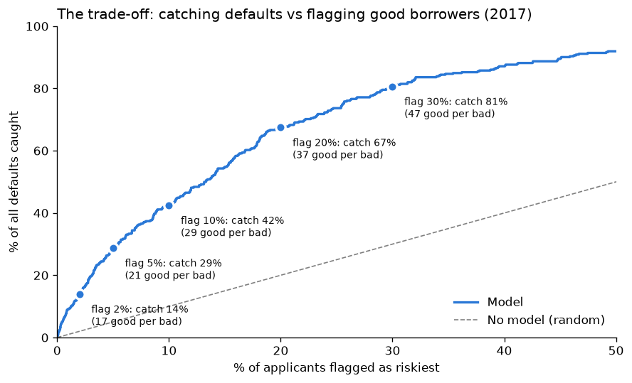
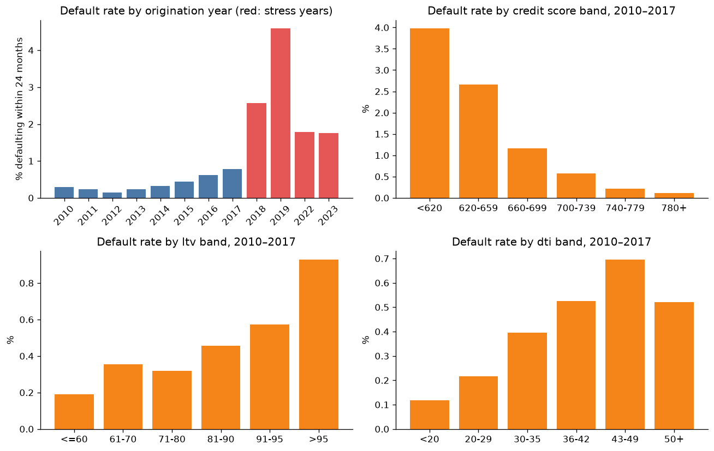
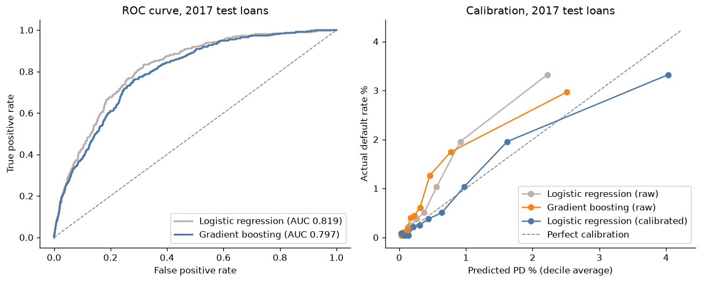
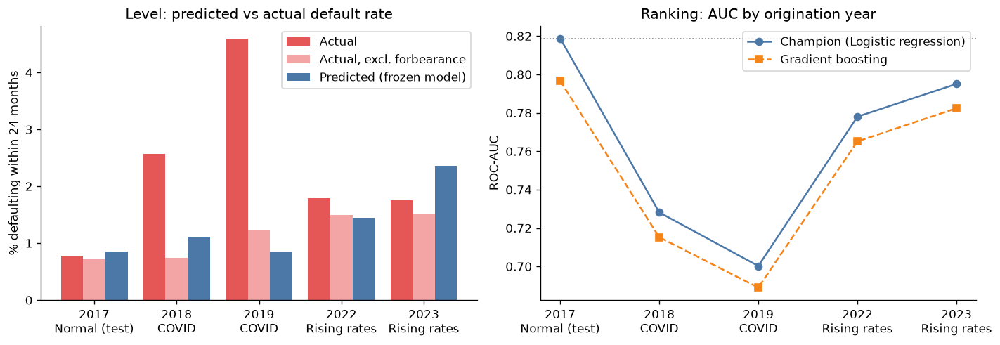
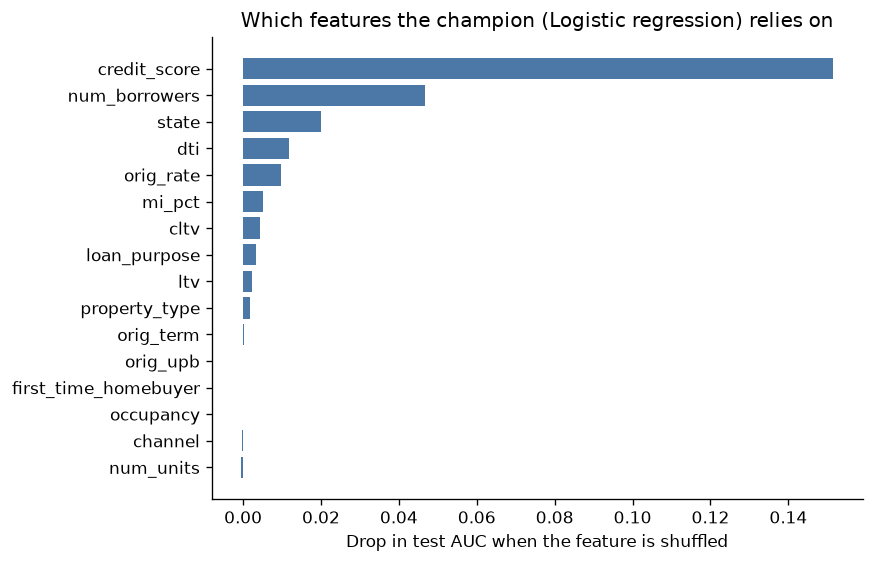
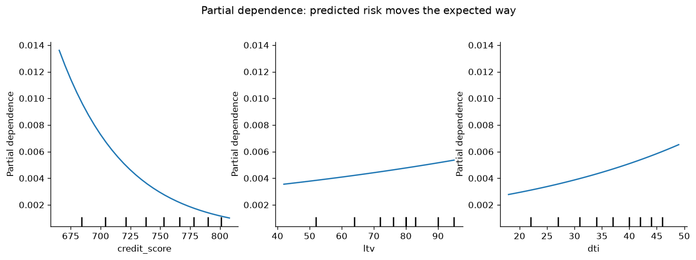
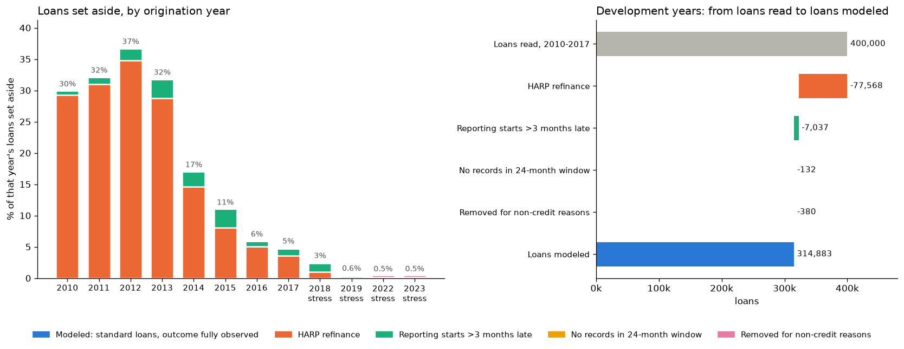

# Predicting mortgage default from the loan application

**Question:** When a bank approves a mortgage, how likely is the borrower to fall 90+ days behind (or cause a loss) within two years? This is the loan's **probability of default (PD)**, which banks use to approve, price and hold capital against loans.

## At a glance

- **Data:** about 315,000 Freddie Mac mortgages made in 2010–2017, plus about 198,000 from 2018–2019 and 2022–2023 for stress tests.
- **Winner:** logistic regression, a simple and transparent model, beat gradient boosting on every year tested.
- **Accuracy on unseen 2017 loans:** AUC 0.82. The riskiest 20% of applicants contain 67% of all defaults, and predicted default rates match actual ones (0.85% vs 0.78%).
- **Business decision:** catching most bad loans costs dozens of good borrowers each, so declines should be rare. The analysis supports approving most applicants, reviewing or pricing up the middle, and declining only above a breakeven PD of about 2–9%.
- **Stress test:** the model's ranking holds up as rates rose (2022–2023) but weakens under COVID, which no application data could foresee.
- **Validity:** a leakage audit confirms the model uses only information available at approval, and quantifies how much the calibration relies on recent outcomes.

## Repository contents

| File | What it is |
|---|---|
| [`credit_default_model.ipynb`](credit_default_model.ipynb) | The analysis, in 8 plain-language sections, each ending with "What we found" |
| [`pd_model.py`](pd_model.py) | Helper code: file reading, models, metrics and charts |
| [`images/`](images/) | Charts used here and in the notebook |
| `data/` | Where the Freddie Mac files go (not included; see *How to run*) |

**Approach:** target built from monthly performance records → population restricted to standard loans with fully observed outcomes → leakage-safe origination features (allow-list) → out-of-time split (train 2010–2015, validate 2016, test 2017) → logistic regression vs. gradient boosting with monotonic constraints, champion chosen on the validation year → calibration → bank metrics (AUC, Gini, KS, PR-AUC, Brier) with bootstrap CIs → **stress test** of the frozen model on COVID-era (2018–2019) and rising-rate (2022–2023) loans → permutation importance and partial dependence.

## Results (2017 loans, out-of-time test)

Trained on 220,365 loans from 2010–2015, tuned and calibrated on 46,975 loans from 2016, and tested once on 47,543 loans from 2017. The 24-month default rate is 0.41% overall and 0.78% in 2017.

| Model | ROC-AUC | Gini | KS | PR-AUC | Brier |
|---|---|---|---|---|---|
| **Logistic regression (champion)** | **0.819** | **0.638** | **0.519** | **0.037** | **0.0076** |
| Gradient boosting, monotonic constraints (challenger) | 0.797 | 0.593 | 0.478 | 0.035 | 0.0077 |

Brier for the champion is after Platt calibration; the other metrics are unaffected by calibration.

- **Logistic regression is the champion.** It scored higher on the 2016 validation year (AUC 0.828 vs 0.818), which is how the champion is chosen, and the 2017 test confirms it: boosting trails by 4.4 Gini points (95% bootstrap CI −6.6 to −2.3). With about 640 training defaults, the simpler model generalizes better.
- **The riskiest 20% of 2017 loans contain 67% of all defaults.** The riskiest 10% default at about 3.3%, against 0.78% overall.
- **Calibration:** Platt scaling on 2016 moves the average predicted PD from 0.48% to 0.85%, against an actual 2017 rate of 0.78%. Default rates rose every year from 2012 (0.14%) to 2017, so PDs need monitoring and recalibration as new vintages season.
- **Main drivers:** credit score by a wide margin, then number of borrowers, state, DTI and interest rate. Partial dependence confirms risk falls with credit score and rises with LTV and DTI.

## Where to draw the line

Defaults are rare (about 1 in 125 loans in 2017), so the model doesn't rebalance the data: rebalancing would distort the probabilities a bank needs for pricing and capital. The trade-off is handled when choosing the cutoff instead:

| Flag the riskiest | Defaults caught | Good borrowers flagged per default caught |
|---|---|---|
| 5% | 29% | 21 |
| 10% | 42% | 29 |
| 20% | 67% | 37 |
| 30% | 81% | 47 |

Declining a loan pays only when expected loss exceeds expected profit. With a loss of 20–40% of the loan on default and a profit of 1–2% over two years, the breakeven PD is about 2–9%, so only 0.3–9% of applicants should be declined outright. The practical policy has three tiers: approve most applicants, review or price up the middle, and decline only above the breakeven PD.



## Stress test: COVID and rising rates

The frozen model (nothing refit) scored on loans whose first two years hit a shock:

| Origination year | Shock | Actual default rate | Excl. forbearance | Predicted | AUC |
|---|---|---|---|---|---|
| 2017 | None (test year) | 0.78% | 0.71% | 0.85% | 0.819 |
| 2018 | COVID | 2.57% | 0.74% | 1.11% | 0.728 |
| 2019 | COVID | 4.59% | 1.22% | 0.83% | 0.700 |
| 2022 | Rising rates | 1.79% | 1.50% | 1.44% | 0.778 |
| 2023 | Rising rates | 1.76% | 1.52% | 2.36% | 0.795 |

- **COVID broke both level and ranking.** About 70% of COVID-era defaults were delinquencies during forbearance (payments paused by agreement). AUC fell to 0.70–0.73 (0.71–0.78 with forbearance set aside): job losses by sector and place aren't visible at origination.
- **Rising rates left ranking largely intact** (AUC 0.78–0.80), but levels drifted. The model overpredicts 2023 because it uses the raw interest rate, and 2023 rates (median 6.75%) are far above anything in the training years.
- **Logistic regression beats boosting in every stress year,** too.
- **Takeaway:** the ranking can support approvals and cutoffs in normal conditions; PD levels need monitoring and recalibration whenever conditions shift.

## Charts







## Methodology notes

**Default definition.** 90+ days delinquent, REO acquisition, or a credit-loss termination (third-party sale, short sale or charge-off, REO disposition) within 24 months of the first payment. Voluntary payoffs count as non-defaults.

**Population.** Of the 400,000 loans read for 2010–2017, 314,883 are used for development. The same rules applied to the 2018, 2019, 2022 and 2023 files leave 197,920 loans for the stress test.



The files contain several loan types the model shouldn't learn from. HARP refinances alone are about a third of 2010–2013 loans and almost vanish by 2018. Development counts:

| Exclusion (applied in order) | Loans removed | Reason |
|---|---|---|
| HARP refinance loans | 77,568 | Streamlined underwriting (no DTI, LTV often above 100%), selected for payment history, and a program that ended in 2018. They default at 1.43% vs 0.41% for standard loans, and they make up 29–35% of 2010–2013 loans but 3.6% of 2017 |
| Monthly reporting starts more than 3 months after first payment | 7,037 | Early months unobserved; keeping them would bias the default rate downward (survivor bias) |
| No performance records in the 24-month window | 132 | Outcome unknown |
| Removed for non-credit reasons (whole-loan sale, reperforming securitization, defect repurchase) before any default | 380 | Outcome unknown |

**Leakage control.** Features come only from an allow-list of 16 fields known at origination (credit score, LTV, CLTV, DTI, rate, loan amount, term, MI, units, borrowers, purpose, occupancy, property type, channel, first-time buyer, state). ZIP code, metro area, seller and servicer are excluded.

**Validation.** Split by origination year, not at random. The 2016 year is used for tuning, champion selection and calibration; the 2017 year is scored once. The stress-test years are only scored, never used for fitting or any choice.

**Leakage checks.** No input uses payment history, and every fitted step (preprocessing, models, calibration) sees only training or validation years. One subtler effect is checked explicitly: outcome windows of 2015–2016 loans overlap the 2017 test period. Refitting with only outcomes available by early 2017 leaves ranking almost unchanged (AUC 0.806 vs 0.819) but halves the predicted PD level (0.39% vs 0.78% actual). So the calibration result means "accurate once recalibrated on recent outcomes," not "forecast in advance."

**COVID forbearance.** Delinquency reported while a loan was in forbearance still counts as default under the main definition; the stress test also reports results with it set aside, using the borrower assistance status field.

**Limitations.**
- The sample has only 44–372 defaults per year, so metrics carry real uncertainty (hence the CIs).
- Development data (2010–2017) covers a benign credit period; the stress test shows PD levels drift under shocks.
- The raw interest rate makes PD levels sensitive to the rate environment (visible in 2023).
- Calibration accuracy relies on recent outcomes (see leakage checks above).
- There are no macroeconomic features.
- Logistic regression can overstate PDs for applicants who combine several extreme characteristics.

**Possible extensions:** interest-rate spread over the market rate, rolling-origin validation, a weight-of-evidence scorecard, SHAP reason codes on hypothetical loans, PSI monitoring and the full dataset.

## How to run

1. Register at Freddie Mac Clarity, open the SFLLD Data Download page and download the sample files `sample_2010.zip` … `sample_2019.zip`, `sample_2022.zip` and `sample_2023.zip` into `data/` (no need to unzip).
2. In VS Code's terminal:
   ```bash
   python3 -m venv .venv && source .venv/bin/activate
   pip install -r requirements.txt
   ```
3. Open `credit_default_model.ipynb`, select the `.venv` kernel, and click **Run All** (about 2 minutes on a laptop). The notebook tells the story section by section; the plumbing (file reading, models, metrics, charts) is in `pd_model.py`.

## Data terms

Freddie Mac Single-Family Loan-Level Dataset (sample files, July 2026 layout; release number: _to add_). Used for noncommercial research under Freddie Mac's [terms and conditions](https://capitalmarkets.freddiemac.com/crt/docs/pdfs/fre_terms_conditions_sflld.pdf). **No loan-level data is published in this repo:** `data/` is gitignored, every table and chart is an aggregate, and the example loans are made up. This project is independent and is not affiliated with or endorsed by Freddie Mac.
